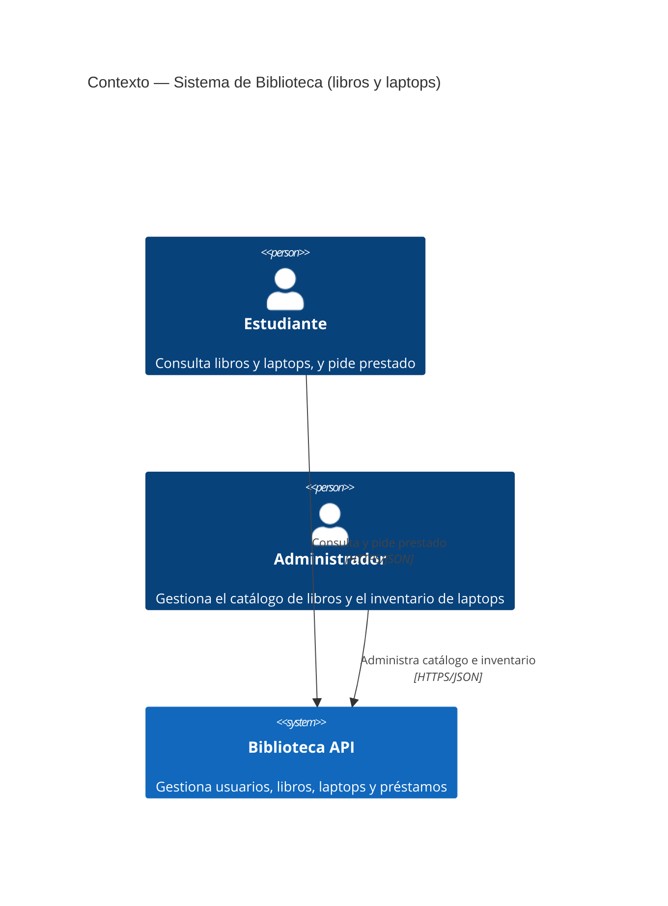
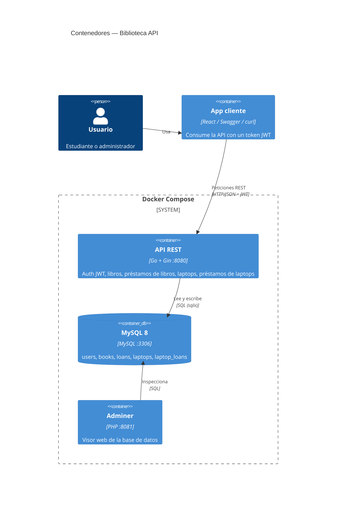
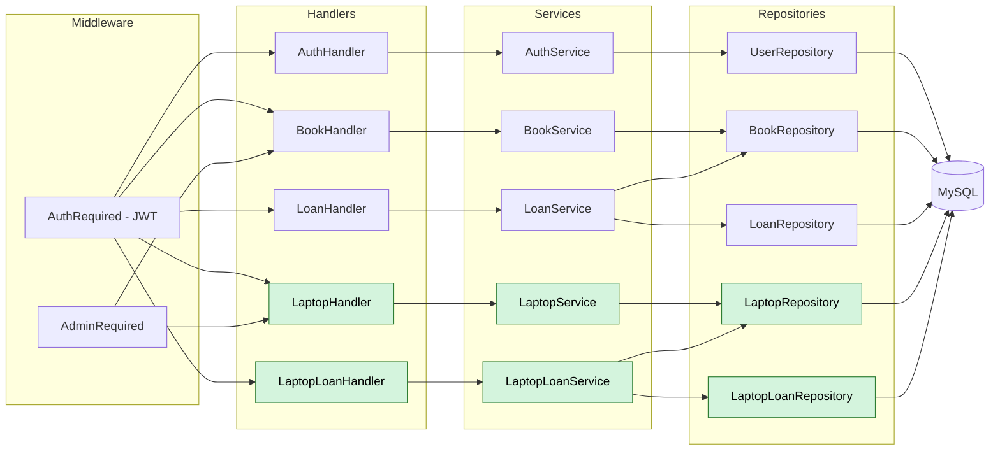
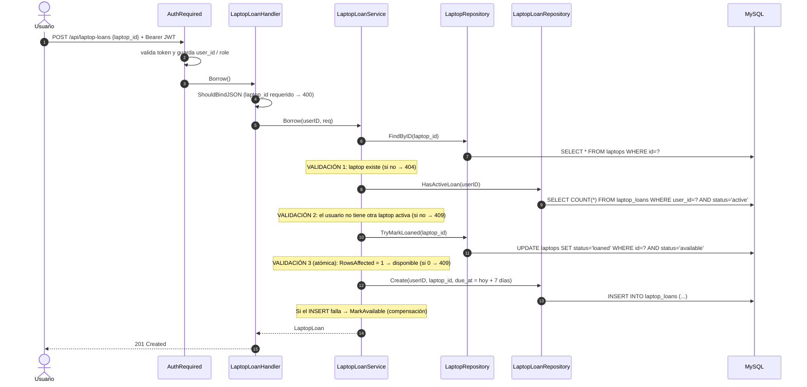
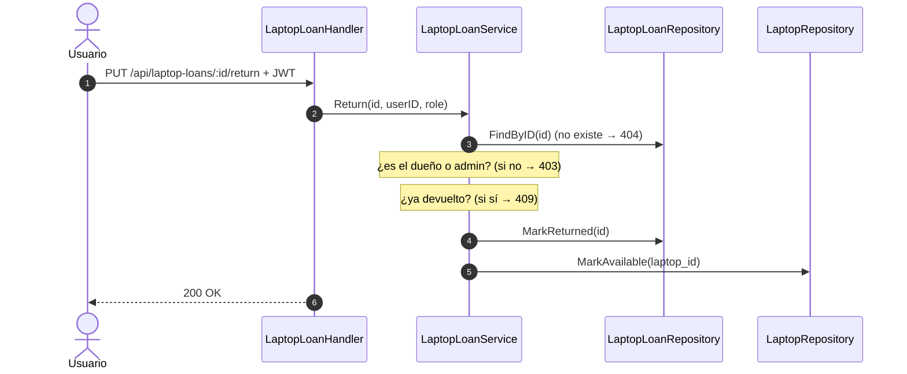

# Fase 5 — Diagramas (Mermaid)

Todos reflejan la decisión del [ADR-001](adr.md): módulo de laptops **paralelo** al de libros, con tablas nuevas `laptops` y `laptop_loans`.

## 1. C4 Nivel 1 — Contexto

## 2. C4 Nivel 2 — Contenedores

## 3. Diagrama de componentes — API con el módulo de laptops

*Verde = componentes nuevos. Los módulos de libros y laptops no se llaman entre sí: ese es el efecto de la opción B.*

## 4. Diagrama de secuencia — "Prestar una laptop"

### Devolución (inventario de vuelta)

